 

**The company website for Ivenza Solutions: modern websites, digital products, automation and brand experiences.**

> 🔒 **Source code is private.** This repository is a public showcase of the project. For demos or collaboration, contact [hello@imadhimthiyas.nl](mailto:hello@imadhimthiyas.nl).

---

## Overview

A fast, single-page marketing site with animated canvas visuals, a brand animation and a contact section. It is plain HTML, CSS and JavaScript with no framework and no build step, so it deploys anywhere that serves static files.

🌐 **Live:** [ivenzasolutions.com](https://ivenzasolutions.com)

## Sections

1. **Hero**: "Digital clarity, built to move"
2. **Services**: end-to-end expertise across web, product, automation and brand
3. **Process**: lean process, serious craft
4. **Founder**: the developer behind the studio
5. **Results**: outcomes over noise
6. **Contact**: start a project

## Highlights

- ⚡ Single `index.html` with inline styles and scripts, with no dependencies to install
- 🎞️ Hero image (WebP), logo set and a looping brand animation
- 🔍 SEO basics: meta description, `robots.txt` and `sitemap.xml`

